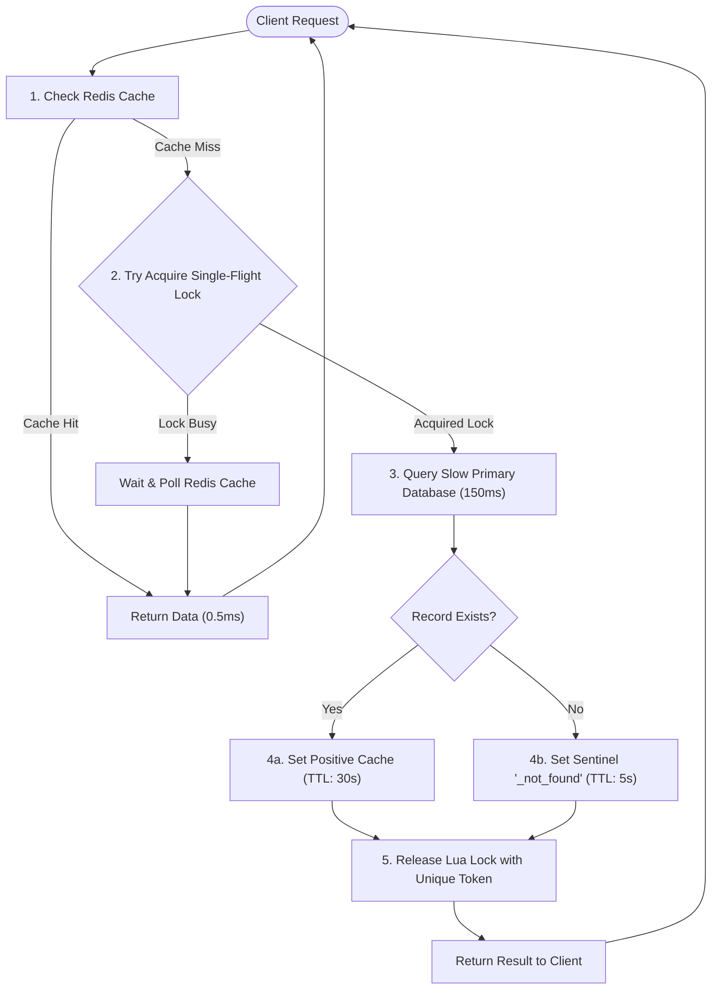

# Production Redis Cache-Aside Pattern in Go

A production-hardened implementation of the **Cache-Aside (Lazy Loading)** pattern using **Go** and **Redis** (`go-redis/v9`), complete with an interactive web telemetry dashboard and CLI simulation.

---

## 🌟 Architecture Overview

In a Cache-Aside architecture, the application code sits between the cache (Redis) and the primary database (e.g., PostgreSQL, MySQL). The application queries Redis first, falling back to the database only on a cache miss, and handles invalidation explicitly when writes occur.



---

## 🚀 Key Production Hardening Features

This implementation hardens the textbook cache-aside pattern against common real-world distributed systems failure modes:

### 1. Multi-Tenant Key Namespacing
In shared Redis deployments, keys are namespaced to avoid collision between microservices:
```text
cache:<namespace>:<entity>:{id}
# Example: cache:billing:product:p-001
# Lock key: lock:cache:billing:product:p-001
```

### 2. Bounded Staleness via Positive TTL
Positive entries carry a configurable expiration window (`TTL: 30s`) acting as an upper-bound safety net against stale data if an invalidation message is dropped or delayed.

### 3. Anti-Penetration Sentinel (Negative Caching)
* **The Vulnerability**: Attackers or rogue jobs probing for non-existent IDs bypass the cache, hammering the slow database on every request.
* **The Defense**: When the primary database returns `nil`, a special sentinel hash (`_not_found = true`) is stored with a short expiration (`NotFoundTTL: 5s`). Subsequent queries are served directly from Redis in **`< 1ms`** without touching the primary database.

### 4. Single-Flight Stampede Protection (Lua Lock)
* When popular or hot keys expire under heavy traffic, thousands of concurrent requests can simultaneously race to query the primary database (Cache Stampede).
* A single-flight distributed lock (`SET lock:<key> <token> NX PX <lock_ttl>`) ensures only **one** request queries the primary database. Concurrent callers wait briefly and are served from cache once populated.
* The lock release uses a Lua script that verifies the caller's unique cryptographic token (`crypto/rand`) before deleting, preventing slow loaders from releasing a lock acquired by another worker.

### 5. Invalidate on Write (Never Attempt In-Place Sync)
* When records are mutated in the database, the cache key is **deleted** (`DEL cache:billing:product:{id}`) rather than rewritten.
* Deletion is atomic, eliminates race conditions between concurrent writes/reads, and guarantees that the next read re-populates cleanly from the primary database.

### 6. Observability & Direct Redis Inspection
Both the interactive UI and CLI provide real-time latency breakdowns, hit-rates, and direct `redis-cli` commands to inspect hash values and remaining TTLs.

---

## 📂 Project Structure

```text
.
├── main.go                     # Entrypoint (dispatches to Web UI demo or CLI example)
├── cache.go                    # Core production RedisCache implementation (Single-flight, Sentinel, Namespacing)
├── primary.go                  # MockPrimaryStore simulating database with configurable read latency
├── demo_server.go              # Interactive HTTP telemetry web server with live UI
├── cache_aside.go              # Standalone CLI demonstration script
├── stampade_protection.Lua     # Reference Lua lock and release scripts
├── go.mod                      # Go module definitions
├── go.sum                      # Dependency checksums
└── README.md                   # Project documentation
```

---

## 🛠️ Getting Started

### Prerequisites
* [Go 1.23+](https://go.dev/dl/)
* [Docker](https://www.docker.com/) (to run Redis)

### 1. Start Redis
Launch a local Redis container on port 6379:
```bash
docker run -d --name redis -p 6379:6379 redis:latest
```

Verify Redis is running:
```bash
docker exec -it redis redis-cli ping
# Response: PONG
```

### 2. Build the Application
```bash
go build -o demo ./...
```

---

## 🖥️ Running the Interactive Demo Server

Start the web dashboard:
```bash
./demo --port 8080 --redis-host localhost --redis-port 6379 --namespace billing
```

Open your browser to:
👉 **[http://localhost:8080](http://localhost:8080)**

### Configurable CLI Flags
| Flag | Default | Description |
|---|---|---|
| `--port` | `8080` | HTTP port for the web dashboard |
| `--redis-host` | `localhost` | Redis host |
| `--redis-port` | `6379` | Redis port |
| `--namespace` | `billing` | Application namespace prefix |
| `--ttl` | `30` | Positive cache TTL in seconds |
| `--not-found-ttl`| `5` | Missing record sentinel TTL in seconds |
| `--lock-ttl-ms` | `2000` | Single-flight lock TTL in milliseconds |
| `--primary-latency-ms` | `150` | Simulated primary database read latency in ms |

---

## 🧪 Running the CLI Simulation

To run the end-to-end flow directly in your terminal:
```bash
./demo example
```

Output:
```text
--- Step 1: Read existing product 'p-001' (Cold read / Miss) ---
Key=cache:billing:product:p-001 | hit=false latency=154.21ms record=map[id:p-001 name:Sourdough Loaf price_cents:650 stock:42]

--- Step 2: Read product 'p-001' again (Cache Hit) ---
Key=cache:billing:product:p-001 | hit=true latency=0.48ms (Direct Redis hit!)

--- Step 3: Read non-existent product 'p-999' (Missing record handling) ---
First query for 'p-999': hit=false is_not_found=true (Sentinel cached for 5s)
Second query for 'p-999': hit=true is_not_found=true latency=0.35ms (Anti-penetration protected!)

--- Step 4: Invalidate on write (Don't try to keep in sync) ---
Primary DB updated; Cache key invalidated (deleted=true)
```

---

## 🔍 Inspecting Directly via `redis-cli`

You can inspect the exact hashes and expiration times inside Redis:

```bash
# 1. Inspect positive cached product hash
docker exec -it redis redis-cli HGETALL cache:billing:product:p-001

# 2. Check remaining TTL
docker exec -it redis redis-cli TTL cache:billing:product:p-001

# 3. Inspect missing-record sentinel hash
docker exec -it redis redis-cli HGETALL cache:billing:product:p-missing-999

# 4. Check sentinel remaining TTL (expires after 5 seconds)
docker exec -it redis redis-cli TTL cache:billing:product:p-missing-999
```

---

## 📄 License
This project is licensed under the Apache 2.0 License.
